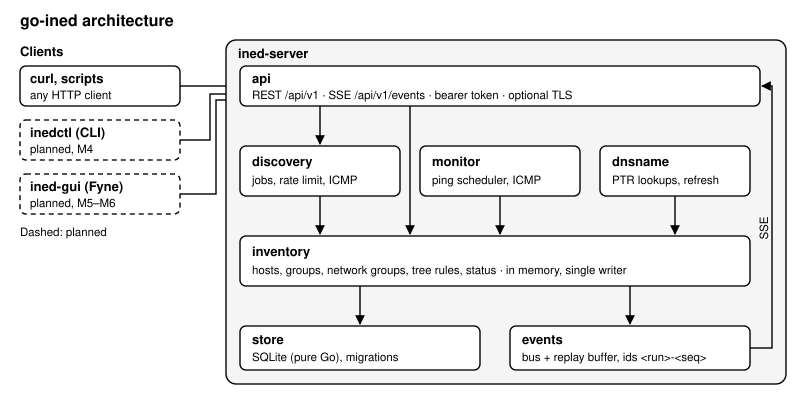
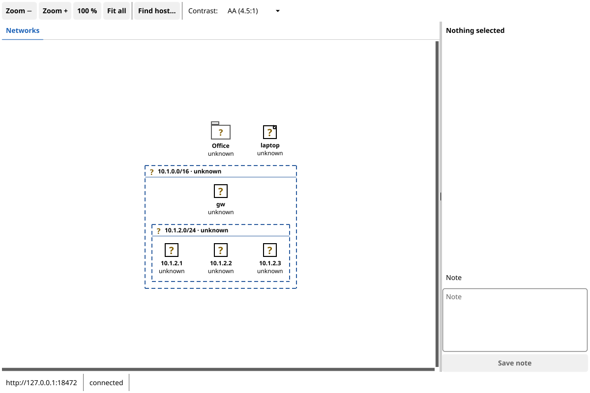

# go-ined

A network monitor loosely modelled on [Tkined](https://github.com/flightaware/scotty) (Scotty), split into three parts:

- **`ined-server`**: a daemon that keeps the inventory in SQLite and serves it over a REST + Server-Sent Events API. It pings every monitored host in the background (IPv4 and IPv6), discovers hosts in IPv4 ranges (also again on a schedule per network), keeps their reverse-DNS names up to date, and, when turned on, reads CPU, memory and disk use over SNMP.
- **`ined-gui`**: a desktop client ([Fyne](https://fyne.io)) that shows hosts and groups on a map per view, with live status. Groups can be collapsed and expanded, as in Tkined, and everything can be edited on the map: drag and drop, adding, editing and deleting, discovery and views.
- **`inedctl`**: a command-line client, built on the Go client package `pkg/client`.

Hosts and groups form a tree. A group with a CIDR is a **network group**: discovery fills it, and a host added by hand goes into the most specific network group that contains its IP address. Every host and group can have a note.

Besides this **network view**, you can make **custom views**: extra maps (tabs in the GUI) with your own groups, for example "Payroll" with the application server, the database and the file share. A host can appear in several views; it is pinged once and has the same status everywhere.



## Status

Early development; the latest release is [0.8.0](Changes.md) (CI and releases since 0.1.0 with M7). **Milestones 1–7 are done**: inventory, network groups, notes, the REST API, bearer-token auth, optional TLS, the TOML config, background ping with up/down status, a live event stream (SSE), discovery of IPv4 ranges, reverse DNS, the Go client package, `inedctl`, custom views, and the GUI with editing (long names wrapped or reflowed, multi-select with Tkined-style keys, host labels per group: name, IP address or both; the key j joins hosts to a group; any group can be shown on its own; a bottom bar to drop items out of a group; a colour for a group's top bar; a group can be copied into a custom view; the map fits the window after a resize; "Connect" on a host opens SSH, RDP, VNC or its web page, with the services the server found ticked). Since 0.6.0 also email alerts per group with `ined-alert` and a read-only token for it, watched services (a status per service on a host, with alerts and a marker in the GUI), and export and import of a network as a JSON file; since 0.7.0 the desktop's own file dialog for export and import, a hover box and a legend (Help ▾ › Map symbols…) that explain the map's signs, and positions saved with one decimal; since 0.8.0 networks scanned again on a schedule, SNMP (CPU with the busiest CPU, memory, disks and uptime; off by default), and in `ined-alert` mails for new hosts and for SNMP values above a line.
See [`architecture/Plan.md`](architecture/Plan.md) for the roadmap.

## Build and run

Requires Go 1.26; the build uses the toolchain go1.26.11 named in `go.mod`, which `go` downloads by itself (unless `GOTOOLCHAIN=local` is set, in which case install go1.26.11 or newer, or the binaries get the older standard library). The server and `inedctl` are pure Go (no cgo). `ined-gui` needs cgo and the X11/OpenGL development packages that [Fyne lists](https://docs.fyne.io/started/) (on Debian/Ubuntu: `gcc libgl1-mesa-dev xorg-dev libwayland-dev libxkbcommon-dev`).

```bash
make            # gofmt check, vet, tests (-race), build into bin/
make build-nogui   # only ined-server and inedctl, without cgo
# or: go build -o bin/ ./cmd/...

bin/ined-server                         # listens on 127.0.0.1:8470
bin/ined-server -listen 127.0.0.1:9000 -db /tmp/ined.db
bin/ined-server -version
```

A quick try:

```bash
INED=http://127.0.0.1:8470
curl -s -X POST $INED/api/v1/groups -d '{"cidr":"192.168.1.0/24"}'
curl -s -X POST $INED/api/v1/hosts  -d '{"ip":"192.168.1.10","name":"nas"}'   # goes into 192.168.1.0/24
curl -s $INED/api/v1/map
curl -sN $INED/api/v1/events                                                  # live events; Ctrl-C to stop
curl -s -X POST $INED/api/v1/discovery -d '{"cidr":"192.168.1.0/24"}'      # find the hosts that answer ping
```

More (verified) calls are in [`architecture/API-examples.md`](architecture/API-examples.md).

The same with `inedctl`:

```bash
bin/inedctl group add --cidr 192.168.1.0/24
bin/inedctl host add 192.168.1.10 --name nas
bin/inedctl discover start 192.168.1.0/24 --wait    # shows progress until the job ends
bin/inedctl host list                               # table; add --json for the API's JSON
echo "replaced disk 3" | bin/inedctl note set host 1
bin/inedctl view add Storage                        # a custom view (id 2)
bin/inedctl view place 2 1                          # show host 1 there too
bin/inedctl view show 2
bin/inedctl group shift 1 --dx 200                  # move group 1 with everything in it
bin/inedctl host services 1 --check                 # which of SSH, RDP, VNC, HTTP(S) answer
bin/inedctl events                                  # live events; Ctrl-C to stop
bin/inedctl -h                                      # all commands
```

`inedctl` exits with 0 on success, 1 for an API error (or a failed discovery job), 2 for a usage error, and 3 when it can't reach the server or the token is wrong. The server URL, token and CA certificate come from `--url`, `--token` and `--ca-cert`, then `INED_URL` / `INED_TOKEN`, then `$XDG_CONFIG_HOME/go-ined/ctl.toml`.

### The GUI

```bash
bin/ined-gui                             # connects to http://127.0.0.1:8470
bin/ined-gui -url https://ined.example.org:8470 -token … -ca-cert ca.pem
```



- One tab per view. Each host shows its status as a shape **and** a word: ● up, ✕ down, ? unknown, a dash for unmonitored hosts; a hollow sign plus "(stale)" until the first ping after a restart.
- Network groups have a double-bordered folder icon and a dashed frame; ordinary groups a plain folder and a solid frame. A folded corner marks a note.
- Double-click a collapsed group to expand it, or the label of a frame to collapse it (also in the right-click menu). This changes the shared state on the server. The group's top-left corner stays in place: the frame opens where the icon was, and the icon appears where the frame started.
- Drag on empty space or use the scroll bars to pan; mouse wheel, the "Zoom 100 % ▾" menu at the toolbar's left, or Ctrl+= / Ctrl+- to zoom, Ctrl+0 for 100 %, Ctrl+1 to fit all, Ctrl+F to find a host.
- Select several items with Ctrl+click or a Shift+drag rubber band (Esc clears). As in Tkined: **g** makes a new group of the selection (it asks for a name), **j** joins the selected hosts to the selected group at their places (it asks which group when several are selected), **c** collapses and **e** expands the selected groups, Delete deletes the selection after one question. A drag on a selected item moves the whole selection.
- Show one group on its own: pick it in the "Show" list in the toolbar (Ctrl+L, type to filter), choose "Show only this group" in its menu, or select it and press **o**. The trail that then appears above the map, and Backspace, go back up. Only your GUI changes; the map stays shared.
- Drag a host, a group icon or a frame (by its label) to move it; a group takes everything in it along. Drop onto a group icon or a frame label (marked "into") to move the item into that group. Esc cancels a drag.
- Right-click empty space for "New group here…" and "New host here…"; right-click an item to edit, move ("Move to group…"), delete it, or, for a host, show it in another view ("Show in view"). For a group, "Show in view" copies it, with its subgroups and hosts, into another custom view. In a custom view, "Remove from this view" takes a host or a group out of that view; the hosts stay in the network view and in other views. Deleting always asks first and says what goes; the Delete key deletes the selected item. When several items are selected and you right-click one of them, the menu acts on the whole selection: "Move N items to group…", "Delete N items…", "Show N items in view", "Remove N items from this view", and for groups "Expand", "Collapse" and "Host labels". The details panel's values can be selected and copied.

- "Connect" in a host's right-click menu opens SSH, Remote desktop (RDP), VNC or the host's web page (http, https). Ticks show which ports answered when the server last checked: it tries TCP 22, 3389, 5900–5909, 80 and 443 when a host is added and every 6 hours after that, and "Check services now" checks at once. The details panel shows the result. Every entry works even without a tick, in case your machine can reach a port the server can't. SSH, RDP and VNC run a command from `gui.toml` `[connect]` (with `{ip}`, `{name}` and `{port}`); on Linux the defaults are `x-terminal-emulator -e ssh {ip}` and Remmina for RDP and VNC (`sudo apt install remmina`). SSH uses your `~/.ssh/config` and user name; for a fixed user set e.g. `ssh = "x-terminal-emulator -e ssh admin@{ip}"`. Commands run without a shell.
- Host labels: "Host labels" in a group's right-click menu chooses what the hosts inside it show: the name, the IP address, or both (the IP below the name). "As the parent group" (the default) takes the mode of the group above it, shown in brackets; at the top level that is the name. The details panel shows the setting too. Without the GUI: `inedctl group labels <id> name|ip|both|inherit`, or `group add --labels`.
- "Discover…" in the toolbar (or "Scan this network" on a network group) finds the hosts that answer ping in an IPv4 range, with progress and a cancel button; closing the dialog leaves the job running, with its progress in the status bar. "Rescan ▸" on an IPv4 network group scans it again every hour, 6 hours, day or week (`inedctl group rescan <id> 24h` for any interval from 15 minutes); the group's details show when it was last scanned and how many hosts were new.
- Long names: "Wrap names" in the toolbar (on by default) breaks a name after its dots where it would run into the next item. "Reflow…" on a group (and "Reflow view…" in the View menu) lays out its members on a grid wide enough for the longest full name; this changes the positions for everyone. Without the GUI: `inedctl view arrange <view> [--group ID] [--width N] [--height N]`.
- "View ▾" creates, renames, moves and deletes views (tabs). The network view can't be deleted.
- The details panel shows the selected item's fields, the views a host is in, and lets you edit its note.
- The contrast selector (AA, AAA, Max, custom) applies at once and is saved in `gui.toml`.
- The status bar shows the connection state and errors.

Settings come from `-url`, `-token` and `-ca-cert`, then `INED_URL` / `INED_TOKEN`, then `$XDG_CONFIG_HOME/go-ined/gui.toml`.

Go programs can use [`pkg/client`](pkg/client): typed calls for every endpoint, `*client.APIError` for API errors, and an event stream that reconnects by itself and resumes where it left off.

## Configuration

Files follow XDG:

| File | Default location |
|------|------------------|
| Server config | `$XDG_CONFIG_HOME/go-ined/server.toml` (falls back to `~/.config/go-ined/server.toml`) |
| Database | `$XDG_DATA_HOME/go-ined/ined.db` (falls back to `~/.local/share/go-ined/ined.db`) |

Every key, with its default, is in [`examples/server.toml`](examples/server.toml) (and `gui.toml` / `ctl.toml` for the clients). Command-line flags override the file.

The server logs to stderr; `[log] level` (`debug`, `info`, `warn`, `error`) and `format` (`text`, `json`) set the detail and format, and `-log-level debug` also logs every API request.

Backup: the database is one SQLite file. While the server runs, copy it with `sqlite3 ined.db ".backup ined-copy.db"` (a consistent copy); with the server stopped, a plain file copy is fine.

Security: by default the server listens on loopback only. To listen on any other address you must set `server.token`; clients then send `Authorization: Bearer <token>`. `server.read_token` adds a second token that can only read (lists, the map and the event stream; anything else gets 403), for scripts that only watch, such as `ined-alert`. Set `server.tls_cert` and `server.tls_key` to turn on TLS. For a self-signed certificate, point the clients' `server.ca_cert` (or `inedctl --ca-cert`) at the certificate's PEM file.

Only one `ined-server` can use a database at a time; a second one refuses to start.

Ping permissions: the server first tries unprivileged ICMP sockets, then raw sockets. If neither works, the server still runs, but it can't scan or monitor: discovery answers 503 with the reason, hosts stay `unknown`, `inedctl health` and the GUI's status bar say so, and the startup log shows the mode in use. On Linux, either of these fixes it. No restart is needed: while it can't ping, the server checks again every minute and before each scan, and the GUI's warning goes away by itself.

```bash
# A: allow unprivileged ping ("ping sockets", not raw sockets) for all groups; covers IPv4 and IPv6
sudo sysctl -w net.ipv4.ping_group_range="0 2147483647"                                  # until the next reboot
echo 'net.ipv4.ping_group_range = 0 2147483647' | sudo tee /etc/sysctl.d/60-ined-ping.conf  # from the next boot on
# B: give only the server binary raw sockets (repeat after every rebuild)
sudo setcap cap_net_raw+ep bin/ined-server
```

Many distributions already allow ping sockets for all groups (option A's value). Set `monitor.enabled = false` to turn background pinging off (discovery still works).

Discovery probes IPv4 ranges up to `/16` (`discovery.max_prefix`) at 200 addresses per second (`discovery.rate`). The server is designed for about 5,000 hosts; a range with more addresses than that logs a warning. Scheduled scans run one at a time, the network waiting longest first; a scan started by hand that covers the network counts as its scan, and stops a scheduled one over the same addresses; `discovery.scheduled = false` turns them all off. With `[new_hosts] enabled = true`, `ined-alert` mails every new host. SNMP is off by default (`[snmp] enabled = false`): community strings go over the network in clear text to every host they are tried on, so set `networks` to your own ranges and keep `server.toml` private. With it on, the server tries `communities` with v2c and then v1, and reads CPU, memory, disks and uptime from HOST-RESOURCES-MIB every 5 minutes; switches and printers usually give their name and uptime only. Reverse DNS uses the system's resolver; set `dns.enabled = false` to turn it off. The service check for the Connect menu (`[services]`) makes one TCP connection per port, not a port scan; set `services.enabled = false` to turn it off.

Watched services: name the services that matter on a host, such as `inedctl host watch 12 ssh,https,tcp:5432`, and the server checks them every 5 minutes (`services.watch_interval`). Each gets its own status: `down` after two failed checks in a row, `up` again after one success. `inedctl host show` and `host list` show them, and every change is a `service.status` event. In `ined-gui`, a host's menu has "Watch services…" (also for several hosts at once), a host with a service down gets a small warning triangle (▲ next to its icon; the sign itself still shows the ping status), and the details panel has a "Watched" row. Selecting the host shows which services are down right below its name, and resting the pointer on a host shows a short box with its status. "Help ▾ › Map symbols…" explains every sign on the map. Nothing is watched until you say so.

Export and import: `inedctl group export 12 -o lan.json` writes a group of the network view with everything below it (subgroups, hosts, notes, watch lists, custom-view placements) to a JSON file; `inedctl import lan.json --parent 3 --dry-run` shows what an import would do on another server, and without `--dry-run` it imports in one step. Hosts or groups that are there already refuse the import, unless `--update`. A matched group is updated where it is, not moved; the report says so. In `ined-gui` a group's menu has "Export…" and "Import into this group…", and empty space has "Import here…".

## Alerting

[`contrib/ined-alert`](contrib/ined-alert/README.md) sends email when a monitored host, or a watched service on it, is down for 2 minutes, and again when it is back, to the people of the groups it is in and to the admins. It runs next to the server, in Python 3.11 or later with nothing to install:

1. In `server.toml`, set `token` and `read_token`, and restart the server.
2. Copy `contrib/ined-alert/alert.toml` to `~/.config/go-ined/alert.toml` and set the read token, `mail.from`, the admins and a `[[route]]` per group, such as `group = "Networks/dc"`.
3. `contrib/ined-alert/ined-alert --check` shows which hosts each route covers; `--test-mail` sends one mail to the admins.
4. Run `contrib/ined-alert/ined-alert`, or install `ined-alert.service` for systemd.

Mail goes through an SMTP relay (`localhost:25`) without login. Alerts within 30 seconds go out as one mail. Every action is logged on stderr and, with `[syslog] address`, to a collector. The admins also hear when the server can't be reached or can't ping.

## Documentation

All design documents live in [`architecture/`](architecture/):

- [`Spec.md`](architecture/Spec.md): requirements (`SPEC-NNN`)
- [`Plan.md`](architecture/Plan.md): decisions and milestones
- [`Tests.md`](architecture/Tests.md): test cases traced to the Spec, with the Go test that covers each one
- `Crosscheck-*.md`: periodic checks of code against the docs

The server describes its API itself: `GET /api/v1/openapi.json` (OpenAPI 3.1, no token needed).

CI runs on every push (`.github/workflows/ci.yml`): gofmt, vet, `staticcheck`, `govulncheck`, the tests with the race detector, raw-socket ICMP as root, and builds for every target. A tag `vX.Y.Z` builds and publishes a release with archives and `SHA256SUMS` (`release.yml`): `ined-server` and `inedctl` for Linux, macOS and Windows on amd64 and arm64, and `ined-gui` for Linux (amd64, arm64), Windows (amd64) and macOS (arm64, amd64). Each GUI is built on its own platform, because Fyne needs cgo. The programs aren't signed: on Windows, SmartScreen asks once ("More info" → "Run anyway"); on macOS, if the GUI was unpacked with Finder, remove the quarantine mark first with `xattr -d com.apple.quarantine ined-gui`. Locally: `make lint` and `make release-build`.

Changes between releases are listed in [`Changes.md`](Changes.md).

## License

[MIT](LICENSE)
