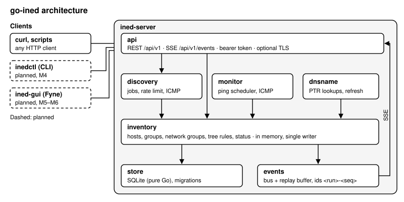

# go-ined

A network monitor loosely modelled on [Tkined](https://github.com/flightaware/scotty) (Scotty), split into three parts:

- **`ined-server`**: a daemon that keeps the inventory in SQLite and serves it over a REST + Server-Sent Events API. It pings every monitored host in the background (IPv4 and IPv6), discovers hosts in IPv4 ranges, and keeps their reverse-DNS names up to date.
- **`ined-gui`** (planned): a desktop client ([Fyne](https://fyne.io)) that shows hosts and groups on one shared map with live status. Groups can be collapsed and expanded, as in Tkined.
- **`inedctl`**: a command-line client, built on the Go client package `pkg/client`.

Hosts and groups form a tree. A group with a CIDR is a **network group**: discovery fills it, and a host added by hand goes into the most specific network group that contains its IP address. Every host and group can have a note.



## Status

Early development. **Milestones 1–4 are done**: inventory, network groups, notes, the REST API, bearer-token auth, optional TLS, the TOML config, background ping with up/down status, a live event stream (SSE), discovery of IPv4 ranges, reverse DNS, the Go client package and `inedctl`.
Next up: views (M4b: extra map tabs with your own grouping of hosts), then the GUI (M5–M6).
See [`architecture/Plan.md`](architecture/Plan.md) for the roadmap.

## Build and run

Requires Go 1.26 or later. The server is pure Go (no cgo).

```bash
make            # gofmt check, vet, tests (-race), build into bin/
# or: go build -o bin/ ./cmd/...

bin/ined-server                         # listens on 127.0.0.1:8470
bin/ined-server -listen 127.0.0.1:9000 -db /tmp/ined.db
bin/ined-server -version
```

A quick try:

```bash
INED=http://127.0.0.1:8470
curl -s -X POST $INED/api/v1/groups -d '{"cidr":"192.168.1.0/24"}'
curl -s -X POST $INED/api/v1/hosts  -d '{"ip":"192.168.1.10","name":"nas"}'   # goes into 192.168.1.0/24
curl -s $INED/api/v1/map
curl -sN $INED/api/v1/events                                                  # live events; Ctrl-C to stop
curl -s -X POST $INED/api/v1/discovery -d '{"cidr":"192.168.1.0/24"}'      # find the hosts that answer ping
```

More (verified) calls are in [`architecture/API-examples.md`](architecture/API-examples.md).

The same with `inedctl`:

```bash
bin/inedctl group add --cidr 192.168.1.0/24
bin/inedctl host add 192.168.1.10 --name nas
bin/inedctl discover start 192.168.1.0/24 --wait    # shows progress until the job ends
bin/inedctl host list                               # table; add --json for the API's JSON
echo "replaced disk 3" | bin/inedctl note set host 1
bin/inedctl events                                  # live events; Ctrl-C to stop
bin/inedctl -h                                      # all commands
```

`inedctl` exits with 0 on success, 1 for an API error (or a failed discovery job), 2 for a usage error, and 3 when it can't reach the server or the token is wrong. The server URL, token and CA certificate come from `--url`, `--token` and `--ca-cert`, then `INED_URL` / `INED_TOKEN`, then `$XDG_CONFIG_HOME/go-ined/ctl.toml`.

Go programs can use [`pkg/client`](pkg/client): typed calls for every endpoint, `*client.APIError` for API errors, and an event stream that reconnects by itself and resumes where it left off.

## Configuration

Files follow XDG:

| File | Default location |
|------|------------------|
| Server config | `$XDG_CONFIG_HOME/go-ined/server.toml` (falls back to `~/.config/go-ined/server.toml`) |
| Database | `$XDG_DATA_HOME/go-ined/ined.db` (falls back to `~/.local/share/go-ined/ined.db`) |

Every key, with its default, is in [`examples/server.toml`](examples/server.toml) (and `gui.toml` / `ctl.toml` for the clients). Command-line flags override the file.

Security: by default the server listens on loopback only. To listen on any other address you must set `server.token`; clients then send `Authorization: Bearer <token>`. Set `server.tls_cert` and `server.tls_key` to turn on TLS. For a self-signed certificate, point the clients' `server.ca_cert` (or `inedctl --ca-cert`) at the certificate's PEM file.

Only one `ined-server` can use a database at a time; a second one refuses to start.

Ping: the server first tries unprivileged ICMP sockets, then raw sockets. On Linux, unprivileged ICMP needs the server's group inside `sysctl net.ipv4.ping_group_range` (many distributions allow all groups). Otherwise, give the binary `CAP_NET_RAW` (`sudo setcap cap_net_raw+ep bin/ined-server`). If neither works, the server still runs: hosts stay `unknown`, and `/api/v1/health` (with a token) reports the problem. The startup log shows the mode in use. Set `monitor.enabled = false` to turn background pinging off (discovery still works).

Discovery probes IPv4 ranges up to `/16` (`discovery.max_prefix`) at 200 addresses per second (`discovery.rate`). The server is designed for about 5,000 hosts; a range with more addresses than that logs a warning. Reverse DNS uses the system's resolver; set `dns.enabled = false` to turn it off.

## Documentation

All design documents live in [`architecture/`](architecture/):

- [`Spec.md`](architecture/Spec.md): requirements (`SPEC-NNN`)
- [`Plan.md`](architecture/Plan.md): decisions and milestones
- [`Tests.md`](architecture/Tests.md): test cases traced to the Spec, with the Go test that covers each one
- `Crosscheck-*.md`: periodic checks of code against the docs

Changes between releases are listed in [`Changes.md`](Changes.md).

## License

[MIT](LICENSE)
