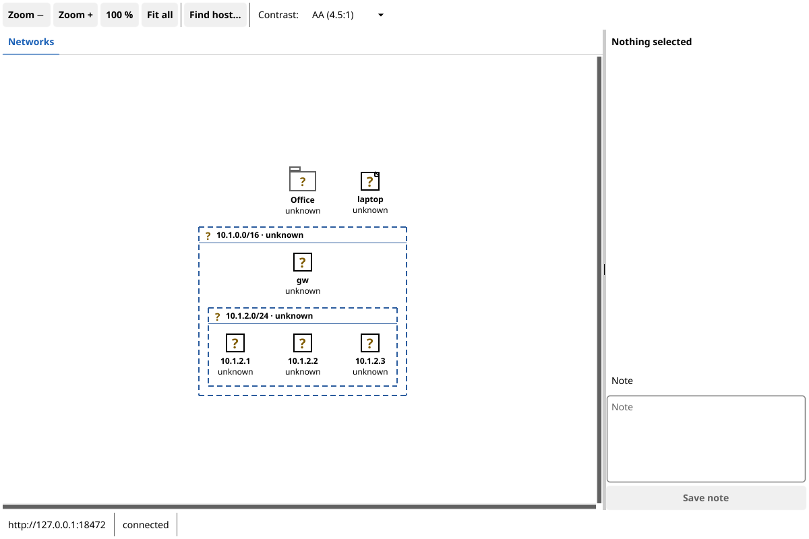

# go-ined

A network monitor loosely modelled on [Tkined](https://github.com/flightaware/scotty) (Scotty), split into three parts:

- **`ined-server`**: a daemon that keeps the inventory in SQLite and serves it over a REST + Server-Sent Events API. It pings every monitored host in the background (IPv4 and IPv6), discovers hosts in IPv4 ranges, and keeps their reverse-DNS names up to date.
- **`ined-gui`**: a desktop client ([Fyne](https://fyne.io)) that shows hosts and groups on a map per view, with live status. Groups can be collapsed and expanded, as in Tkined, and everything can be edited on the map: drag and drop, adding, editing and deleting, discovery and views.
- **`inedctl`**: a command-line client, built on the Go client package `pkg/client`.

Hosts and groups form a tree. A group with a CIDR is a **network group**: discovery fills it, and a host added by hand goes into the most specific network group that contains its IP address. Every host and group can have a note.

Besides this **network view**, you can make **custom views**: extra maps (tabs in the GUI) with your own groups, for example "Payroll" with the application server, the database and the file share. A host can appear in several views; it is pinged once and has the same status everywhere.


## Status

Early development. **Milestones 1–6 are done**: inventory, network groups, notes, the REST API, bearer-token auth, optional TLS, the TOML config, background ping with up/down status, a live event stream (SSE), discovery of IPv4 ranges, reverse DNS, the Go client package, `inedctl`, custom views, and the GUI with editing.
Next up: CI and release 0.1.0 (M7).
See [`architecture/Plan.md`](architecture/Plan.md) for the roadmap.

## Build and run

Requires Go 1.26; the build uses the toolchain go1.26.11 named in `go.mod`, which `go` downloads by itself (unless `GOTOOLCHAIN=local` is set, in which case install go1.26.11 or newer, or the binaries get the older standard library). The server and `inedctl` are pure Go (no cgo). `ined-gui` needs cgo and the X11/OpenGL development packages that [Fyne lists](https://docs.fyne.io/started/) (on Debian/Ubuntu: `gcc libgl1-mesa-dev xorg-dev libwayland-dev libxkbcommon-dev`).

```bash
make            # gofmt check, vet, tests (-race), build into bin/
make build-nogui   # only ined-server and inedctl, without cgo
# or: go build -o bin/ ./cmd/...

bin/ined-server                         # listens on 127.0.0.1:8470
bin/ined-server -listen 127.0.0.1:9000 -db /tmp/ined.db
bin/ined-server -version
```

A quick try:

```bash
INED=http://127.0.0.1:8470
curl -s -X POST $INED/api/v1/groups -d '{"cidr":"192.168.1.0/24"}'
curl -s -X POST $INED/api/v1/hosts  -d '{"ip":"192.168.1.10","name":"nas"}'   # goes into 192.168.1.0/24
curl -s $INED/api/v1/map
curl -sN $INED/api/v1/events                                                  # live events; Ctrl-C to stop
curl -s -X POST $INED/api/v1/discovery -d '{"cidr":"192.168.1.0/24"}'      # find the hosts that answer ping
```

More (verified) calls are in [`architecture/API-examples.md`](architecture/API-examples.md).

The same with `inedctl`:

```bash
bin/inedctl group add --cidr 192.168.1.0/24
bin/inedctl host add 192.168.1.10 --name nas
bin/inedctl discover start 192.168.1.0/24 --wait    # shows progress until the job ends
bin/inedctl host list                               # table; add --json for the API's JSON
echo "replaced disk 3" | bin/inedctl note set host 1
bin/inedctl view add Storage                        # a custom view (id 2)
bin/inedctl view place 2 1                          # show host 1 there too
bin/inedctl view show 2
bin/inedctl group shift 1 --dx 200                # move group 1 with everything in it
bin/inedctl events                                  # live events; Ctrl-C to stop
bin/inedctl -h                                      # all commands
```

`inedctl` exits with 0 on success, 1 for an API error (or a failed discovery job), 2 for a usage error, and 3 when it can't reach the server or the token is wrong. The server URL, token and CA certificate come from `--url`, `--token` and `--ca-cert`, then `INED_URL` / `INED_TOKEN`, then `$XDG_CONFIG_HOME/go-ined/ctl.toml`.

### The GUI

```bash
bin/ined-gui                             # connects to http://127.0.0.1:8470
bin/ined-gui -url https://ined.example.org:8470 -token … -ca-cert ca.pem
```



- One tab per view. Each host shows its status as a shape **and** a word: ● up, ✕ down, ? unknown, a dash for unmonitored hosts; a hollow sign plus "(stale)" until the first ping after a restart.
- Network groups have a double-bordered folder icon and a dashed frame; ordinary groups a plain folder and a solid frame. A folded corner marks a note.
- Double-click a collapsed group to expand it, or the label of a frame to collapse it (also in the right-click menu). This changes the shared state on the server. The group's top-left corner stays in place: the frame opens where the icon was, and the icon appears where the frame started.
- Drag on empty space or use the scroll bars to pan; mouse wheel or Ctrl+= / Ctrl+- to zoom, Ctrl+0 for 100 %, Ctrl+1 to fit all, Ctrl+F to find a host.
- Drag a host, a group icon or a frame (by its label) to move it; a group takes everything in it along. Drop onto a group icon or a frame label (marked "into") to move the item into that group. Esc cancels a drag.
- Right-click empty space for "New group here…" and "New host here…"; right-click an item to edit, move ("Move to group…"), delete it, or, for a host, show it in another view ("Show in view") or remove it from the current custom view. Deleting always asks first and says what goes; the Delete key deletes the selected item.
- "Discover…" in the toolbar (or "Scan this network" on a network group) finds the hosts that answer ping in an IPv4 range, with progress and a cancel button; closing the dialog leaves the job running, with its progress in the status bar.
- Long names: "Wrap names" in the toolbar (on by default) breaks a name after its dots where it would run into the next item. "Reflow…" on a group (and "Reflow view…" in the View menu) lays out its members on a grid wide enough for the longest full name; this changes the positions for everyone. Without the GUI: `inedctl view arrange <view> [--group ID] [--width N] [--height N]`.
- "View ▾" creates, renames, moves and deletes views (tabs). The network view can't be deleted.
- The details panel shows the selected item's fields, the views a host is in, and lets you edit its note.
- The contrast selector (AA, AAA, Max, custom) applies at once and is saved in `gui.toml`.
- The status bar shows the connection state and errors.

Settings come from `-url`, `-token` and `-ca-cert`, then `INED_URL` / `INED_TOKEN`, then `$XDG_CONFIG_HOME/go-ined/gui.toml`.

Go programs can use [`pkg/client`](pkg/client): typed calls for every endpoint, `*client.APIError` for API errors, and an event stream that reconnects by itself and resumes where it left off.

## Configuration

Files follow XDG:

| File | Default location |
|------|------------------|
| Server config | `$XDG_CONFIG_HOME/go-ined/server.toml` (falls back to `~/.config/go-ined/server.toml`) |
| Database | `$XDG_DATA_HOME/go-ined/ined.db` (falls back to `~/.local/share/go-ined/ined.db`) |

Every key, with its default, is in [`examples/server.toml`](examples/server.toml) (and `gui.toml` / `ctl.toml` for the clients). Command-line flags override the file.

The server logs to stderr; `[log] level` (`debug`, `info`, `warn`, `error`) and `format` (`text`, `json`) set the detail and format, and `-log-level debug` also logs every API request.

Backup: the database is one SQLite file. While the server runs, copy it with `sqlite3 ined.db ".backup ined-copy.db"` (a consistent copy); with the server stopped, a plain file copy is fine.

Security: by default the server listens on loopback only. To listen on any other address you must set `server.token`; clients then send `Authorization: Bearer <token>`. Set `server.tls_cert` and `server.tls_key` to turn on TLS. For a self-signed certificate, point the clients' `server.ca_cert` (or `inedctl --ca-cert`) at the certificate's PEM file.

Only one `ined-server` can use a database at a time; a second one refuses to start.

Ping permissions: the server first tries unprivileged ICMP sockets, then raw sockets. If neither works, the server still runs, but it can't scan or monitor: discovery answers 503 with the reason, hosts stay `unknown`, `inedctl health` and the GUI's status bar say so, and the startup log shows the mode in use. On Linux, either of these fixes it. No restart is needed: while it can't ping, the server checks again every minute and before each scan, and the GUI's warning goes away by itself.

```bash
# A: allow unprivileged ping ("ping sockets", not raw sockets) for all groups; covers IPv4 and IPv6
sudo sysctl -w net.ipv4.ping_group_range="0 2147483647"                                  # until the next reboot
echo 'net.ipv4.ping_group_range = 0 2147483647' | sudo tee /etc/sysctl.d/60-ined-ping.conf  # from the next boot on
# B: give only the server binary raw sockets (repeat after every rebuild)
sudo setcap cap_net_raw+ep bin/ined-server
```

Many distributions already allow ping sockets for all groups (option A's value). Set `monitor.enabled = false` to turn background pinging off (discovery still works).

Discovery probes IPv4 ranges up to `/16` (`discovery.max_prefix`) at 200 addresses per second (`discovery.rate`). The server is designed for about 5,000 hosts; a range with more addresses than that logs a warning. Reverse DNS uses the system's resolver; set `dns.enabled = false` to turn it off.

## Documentation

All design documents live in [`architecture/`](architecture/):

- [`Spec.md`](architecture/Spec.md): requirements (`SPEC-NNN`)
- [`Plan.md`](architecture/Plan.md): decisions and milestones
- [`Tests.md`](architecture/Tests.md): test cases traced to the Spec, with the Go test that covers each one
- `Crosscheck-*.md`: periodic checks of code against the docs

The server describes its API itself: `GET /api/v1/openapi.json` (OpenAPI 3.1, no token needed).

CI runs on every push (`.github/workflows/ci.yml`): gofmt, vet, `staticcheck`, `govulncheck`, the tests with the race detector, raw-socket ICMP as root, and builds for every target. A tag `vX.Y.Z` builds and publishes a release with archives and `SHA256SUMS` (`release.yml`). Locally: `make lint` and `make release-build`.

Changes between releases are listed in [`Changes.md`](Changes.md).

## License

[MIT](LICENSE)
